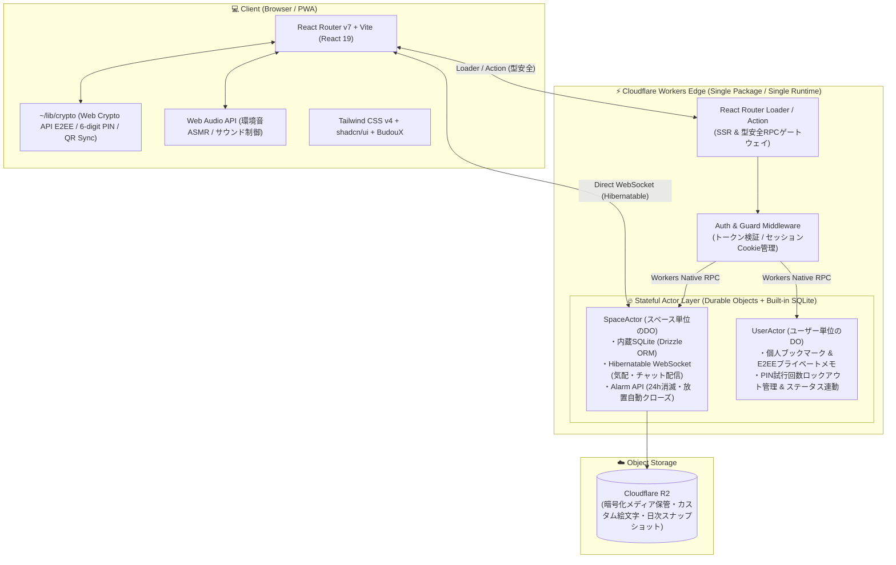

# プロダクト概要書：Irori（イロリ）

**コンセプト:** 「沈黙すら心地よい、温かな暗闇と灯り。シーンに合わせてノリと距離感をチューニングし、ゼロ知識E2EEで守られた空間に集う次世代プライベート・チャット」

Irori（イロリ）は、親密な少人数グループから中規模コミュニティに向けた、エンドツーエンド暗号化（E2EE）標準対応のリアルタイムチャットサービスです。常時接続や即レスのプレッシャーから解放され、炭火のゆらぎや環境音とともに、ただそこに居るだけで安心できる空間を提供します。

---

## 1. 企画背景とコア思想

### 1.1 企画背景：常時接続時代のコミュニケーション疲労とプライバシー課題

現代のSNSやビジネスチャットツールは「常時接続・即レス・数字による評価」を前提として設計されていることが多く、利用者は無意識のうちにコミュニケーション疲れ（通知疲れ、既読プレッシャー、公私の文脈混在）を抱えています。同時に、従来のチャットサービスには以下の構造的課題が存在します。

1. **評価と即応のプレッシャー**:
   フォロワー数、リアクション数、既読表示などが可視化されることで、「早く返信しなければならない」「気の利いた発言をしなければならない」という心理的負荷が生じ、言葉を選ぶこと自体が億劫になる現象が起きています。

2. **プライバシーとデータ主権の懸念**:
   一般的なチャットサービスの多くはメッセージ本文をサーバー上で平文（またはサービス運営者が復号可能な状態）で保存しています。真に親密で安全なプライベート空間を求めるユーザーにとって、運営者や第三者に覗き見られないゼロ知識暗号化（E2EE）の担保は不可欠な要件です。

3. **画一的な距離感と文脈の混在**:
   部屋や相手によって求められる「ノリ」や「距離感」は異なります。しかし、多くのツールでは既読表示やタイピング表示、メッセージの保存期間などを細かくチューニングできず、プライベートな雑談から作業部屋までを1つの空間で心地よく使い分けることが困難でした。

Irori は、これらの課題を根本から解決し、「温かく、ゆっくりとした時間が流れる、沈黙すら許されるオンラインの居場所」を提供するために設計されたプロダクトです。

### 1.2 「囲炉裏（Irori）」の空気感と認知負荷ゼロのUI原則

Irori の本質的価値は、古民家の囲炉裏端に集まっているかのような安心感にあります。ただし、これをプロダクトへ落とし込むにあたり、以下の**「モチーフ適用の鉄則（アンチ・ゲーミフィケーション原則）」**を定めています。

- **物体的モチーフの転用による「独自用語化」の禁止**:
  - 「餅を焼く」「灰に文字を書く」「薪をくべる」「のれん」といった具象物を機能名やUIラベルに転用しません。ゲームではない日常ツールにおいて、アプリ独自の隠語や比喩表現は「これは何の機能か？」を脳内で翻訳させる認知負荷（ノイズ）になります。
  - UI上の機能名は**「スペース」「チャンネル」「ブックマーク」「ステータスメモ」「トピック」**など、標準的なチャットツールに親しんだユーザーが直感的に理解できる用語に徹底統一します。

- **「雰囲気（光・音・温度・間）」へのモチーフ昇華**:
  - 囲炉裏のモチーフは用語ではなく、**視覚（古民家の夜のような漆黒と炭火のアンバーの明滅）、聴覚（パチパチと爆ぜる環境音ASMR）、空気感（発言しなくても同じ部屋で灯りを眺めていられるプレゼンス表現、会話の熱量に応じた光のゆらぎ）**という「空間の演出」に純化して活用します。

### 1.3 ターゲットユーザーと利用シーン

- **SNSや即レス文化に疲れている人**:
  「いいね」の数やフォロワー数、既読スルーの罪悪感から解放され、自分のペースでぽつりぽつりと言葉を交わしたい層。

- **ゆるい繋がりと「心地よい沈黙」を求める人**:
  1人で夜を過ごすのは少し寂しいが、テンションの高いボイスチャットはしたくない夜更かし層。同じ部屋にログインして灯りを共有するだけで「一緒にいる安心感」を得たい層。

- **作業・読書のお供（もくもく作業）を探している人**:
  炭火の環境音（ASMR）と「同じ空間に誰かがいる静かな気配」を感じながら、自分の作業や読書に集中したい層。

- **親密な少人数グループ〜中規模コミュニティ**:
  4〜6人で深く静かに語り合うクローズドな集まりから、トピックごとにチャンネルを分けて交流するスペースまで、空間のサイズとノリを自在に調整したい層。

### 1.4 技術設計の思想：単一ランタイムによる高凝集アーキテクチャ

Irori は、優れたユーザー体験を最小限のインフラ複雑性で実現するため、**「React Router v7 + Cloudflare Durable Objects（SQLite内蔵）」**による**シングルパッケージ構成（単一の `package.json`）**を採用しています。

- **Cloudflare Workers 単一ランタイム統合**:
  React Router v7 の Framework Mode（Loader / Action による型安全ルート生成・SSR）と Durable Objects を、`@cloudflare/vite-plugin` を用いて単一の Worker エントリーポイントに集約します。これにより、フロントエンドとバックエンドのインフラ分断を解消し、単一のデプロイフローで完結させます。

- **SQLite-backed Durable Objects によるテナント分離**:
  スペース（部屋）ごとにステートフルな Actor（Durable Object）と専用の SQLite データベースを割り当てます。DB への書き込みと WebSocket ブロードキャストが同一プロセス内で完結するため、超低遅延のリアルタイム同期と、Alarm API によるミリ秒単位の正確な自動消滅処理を実現します。

- **クライアントサイド E2EE（React Router v7 `clientLoader` / `clientAction` 統合）**:
  Web Crypto API を活用し、暗号化・復号・鍵管理をブラウザ側で完結させます。React Router v7 の `clientLoader` による透過的な自動復号と `clientAction` による平文流出遮断を組み合わせ、サーバーには暗号文と暗号化ボールトのみを扱わせます。端末ローカルでの安全な鍵保持（`extractable: false`、`navigator.storage.persist()`、WebAuthn連携）に加え、LINEライクな「6桁バックアップPIN」と「QRコード端末間引き継ぎ」により、一般ユーザーでも直感的に鍵を管理・復元できる堅牢なUXを提供します。

---

## 2. コアバリュー：7つの体験目標と実現設計

### 2.1 「沈黙」と「気配」が心地よい空間演出（Irori Atmosphere）

何か面白いことを発言しなくても、リアクションを返さなくても、ただそこに居るだけで成立するコミュニケーション体験を提供します。

- **会話の温度を映す「アンビエント・ライト（灯りのゆらぎ）」**:
  画面背景やヘッダーの微細なアンバーの灯りが、空間内の滞在人数や会話のテンポ（熱量）に応じて、炭火の呼吸のようにじんわりと明度や彩度を変えます。会話が止まっている時は穏やかな微光へと落ち着き、沈黙が気まずくならない視覚効果を生み出します。

- **環境音（ASMR）サウンドスケープ**:
  チャンネルに入室中、パチパチと炭が爆ぜる音、静かな夜の虫の声、雨音などの環境音をクライアント側で小さく再生できます（ワンタップでミュート・音量調節可能）。作業用BGMや「同じ空間で静かに過ごす」体験を支えます。

- **「ただ居るだけ」を許容するプレゼンス（気配）表示**:
  ボイスチャットを繋がなくても、「現在このチャンネルで灯りを眺めている（滞在している）メンバー」のアバターが画面隅に控えめに並び、無言の同席（作業・読書・寝落ち前のひととき）を共有できます。Durable Object の WebSocket 接続状態からインメモリでミリ秒単位に算出します。

- **自然消滅する「ショート滞在ルーム（自動クローズ機能）」**:
  「今夜だけ少し集まろう」という一時ルームを作成可能です。参加者が全員退室するか、一定時間（例：6時間〜24時間）会話が途絶えると、Durable Object の Alarm API によりルームの SQLite ストレージ自体が物理破棄され、データを残さず自動で閉じます。

### 2.2 ゼロ知識エンドツーエンド暗号化（E2EE）による完全なプライバシー保護

サービス運営者やクラウドインフラ事業者でさえメッセージ内容や添付メディアを閲覧できない、**Zero-Knowledge E2EE** を標準提供します。

- **エンベロープ暗号化の適用**:
  - **1対1 DM**: 端末間の ECDH（P-256）鍵交換により共有シークレットを導出し、ルームマスターキー（RMK）を確立します。
  - **スペース（複数人空間）**: スペース作成時に AES-GCM 256bit のスペースマスターキー（SMK）を生成します。参加承認されたメンバーの公開鍵、またはスペース共通パスコード導出鍵（PBKDF2 300,000回）で SMK を暗号化（ラップ）して配布します。
  - **メッセージ単位の暗号化**: メッセージ送信ごとにデータ暗号化鍵（DEK）を用いて本文を AES-GCM 暗号化します。サーバー側の Durable Object には暗号文と初期化ベクトル（IV）のみが保管されます。

- **React Router v7 `clientLoader` / `clientAction` による透過的暗号処理**:
  - **透過的初期復号 (`clientLoader.hydrate = true`)**: サーバーの `loader` は DB から暗号文のみを取得し、ブラウザの `clientLoader` 内で IndexedDB の鍵を用いて一括復号してからコンポーネントへ渡します。これにより、UI コンポーネントは暗号化を意識せず平文をそのままレンダリングできます。
  - **平文流出の構造的遮断 (`clientAction`)**: メッセージ送信時、ブラウザの `clientAction` が `formData.delete("message")` で平文フィールドを消去し、暗号文・IV に差し替えてからサーバーへ送出します。平文がネットワーク通信やサーバーログに乗る事故をフレームワーク層で構造的に防ぎます。
  - **鍵ロストの自動検知とガードルート**: ブラウザのデータ消去等で IndexedDB の鍵が見つからない場合、`clientLoader` が即座に検知し、復元画面（`/restore-key`）へ自動リダイレクトします。

- **LINEライクな鍵保存 ＆ シームレス解錠（端末ローカル保持）**:
  秘密鍵はサーバーへ送信せず、端末ローカル（ブラウザの IndexedDB / Web Crypto API）に厳格に保持されます。
  - **抽出不可鍵 (`extractable: false`)**: 鍵生成・復元時には Web Crypto API の `unwrapKey` を直接実行し、メモリ上に平文バイト列を露出させずに `extractable: false` の状態で IndexedDB へ保存します。万が一 XSS 脆弱性が発生しても、スクリプトによる秘密鍵の持ち出しを防御します。
  - **ストレージ永続化 (`navigator.storage.persist()`)**: 初回鍵登録時にブラウザへストレージ永続化を要求し、iOS Safari 等の ITP による IndexedDB の自動パージを抑止します。
  - **生体認証アンロック**: 日常利用時は Touch ID、Face ID、Windows Hello などの生体認証（WebAuthn / パスキー）やセッションと連動し、毎回のパスワード入力を意識させることなく瞬時に鍵を解錠します。

- **LINEライクな「6桁バックアップPIN」によるクラウド保管**:
  暗号通貨のような煩雑なリカバリーファイル（PDFやPNGカード）の保存・管理を強要せず、LINEのトークバックアップと同様に、ユーザー自身が設定する**「6桁のバックアップPINコード」**を用いた鍵保管を提供します。
  - **端末側ストレッチング導出**: クライアント上で 6桁PIN + ソルトから高負荷 KDF（Argon2id または PBKDF2 310,000回）によってバックアップ用鍵（AES-KW 256bit）を導出し、ユーザー秘密鍵を暗号化（ラップ）してエッジストレージ（UserActor）に退避します。
  - **ブルートフォース防御（サーバー側ロックアウト ＋ 環境シークレット結合）**: サーバー側（UserActor）で PIN の検証試行回数を厳格に制御し、5回連続で入力を誤った場合は一定時間のアカウント凍結（指数バックオフ）を実施します。さらに Cloudflare Workers の環境シークレット（Pepper）を導出チェーンに挟むことで、暗号化ボールトを第三者がローカルでGPU全探索（オフライン総当たり）する攻撃を暗号学的に完全遮断します。
  - **ワンタップ復元**: 新端末への移行時やブラウザキャッシュクリア時も、本人認証後に「6桁PIN」を入力するだけで、直ちに過去の暗号鍵を復元できます。

- **「かんたん引き継ぎ ＆ サブ端末ログインQRコード」**:
  新端末（PCやスマートフォン）を追加する際、新端末の画面に表示されるワンタイムQRコードをログイン済み端末のカメラでスキャンするだけで、端末間での安全な暗号化ハンドシェイク（ECDH P2P鍵交換）を行い、秘密鍵を新端末へ直接転送できます。手動のPIN入力すら不要で、LINEのように直感的にデバイス間連携が完了します。

- **平文メタデータと暗号化対象の厳格な分離**:
  - **暗号化対象（E2EE）**: メッセージ本文、スレッド返信本文、一時ステータスメモ、メディアURL・ファイル、ワークフロー入力値、ノート本文、個人用ブックマークメモ。
  - **平文対象（ルーティング・集計用）**: スペースID、チャンネル名、送信者ID、タイムスタンプ、絵文字リアクション種別、メンション対象ID、未読カーソル位置。

### 2.3 視認性と会話リズムを重視したバブルUI

ビジネスチャットにありがちな「左揃えテキストの羅列」による認知負荷を避け、直感的に会話の流れを掴める左右バブルレイアウトを採用します。

- **左右非対称バブルレイアウト**:
  - **相手のメッセージ**: 左寄せ配置、アバター＋表示名、深みのあるサーフェスカラー（`#18181C`）の角丸バブル。
  - **自分のメッセージ**: 右寄せ配置、炭火の温もりを思わせるウォームアンバー系の背景（`#261712` に繊細なオレンジ境界）で、暗い画面でも目を疲れさせずに自他の発言を瞬時に識別できます。

- **1メッセージ＝1バブルの完全独立（自動結合・グルーピングの完全排除）**:
  同一ユーザーによる短時間の連投であっても、メッセージを勝手に1つの塊に合体（グルーピング）せず、すべての発言を独立した1つのバブルとして表示します。これにより、「ぽつりぽつりと呟く会話のリズム」を損なわず、各メッセージに対する絵文字リアクション、個別スレッド返信、ブックマーク、送信取消・編集を1件単位で直感的に行えます。

- **バブル外の控えめなメタデータ配置**:
  送信時刻や既読表示（ON時のみ）はバブルのすぐ外側（下端脇）に小さく配置し、バブル内の本文表示をすっきりと保ちます。

- **日本語タイポグラフィの最適化**:
  行高（`1.65`）と文字間隔を調整し、BudouX による自然な文脈折り返しを組み込むことで、スマートフォン画面でも美しく読みやすい文字組を実現します。

### 2.4 柔軟な空間設計と手軽なリアクション・空気感調整

親密な小部屋から複数チャンネルを持つコミュニティまで、標準的で迷わない用語とUIで手軽にカスタマイズできます。

- **空間構造「スペース × チャンネル」**:
  - 1つの招待制スペースの中に、用途別のチャンネル（`#雑談`、`#作業部屋`、`#連絡` など）をワンクリックで作成し、ドラッグ＆ドロップで並び替えできます。
  - **少人数定員設定と自動縮退**: スペースやチャンネルごとに定員（例：最大6名）を設定可能です。また、チャンネルが1つだけのスペースではチャンネル一覧サイドバーを自動で非表示にし、シンプルなシングルルーム表示に切り替わります。

- **高速絵文字リアクション ＆ カスタム絵文字・スタンプ**:
  - **ワンタップリアクション**: メッセージホバー（モバイルは長押し）で頻出絵文字のクイックバーが表示され、1タップでリアクションできます。
  - **言葉を使わない労わり・共感**: 文章を考える余裕がない時でも、「🍵（一息ついてね）」「🔥（聞いてるよ）」「🙏（ありがとう）」といったスタンプで気負わずに感情を伝えられます。
  - **スペース単位のカスタム絵文字**: スペースごとにオリジナルの画像（PNG / WebP / GIF / SVG）をカスタム絵文字（`:emoji_name:`）としてアップロード・登録できます。絵文字ピッカーからの選択はもちろん、本文中へのインライン挿入やメッセージリアクションとして利用でき、コミュニティ固有の文化やノリを豊かに育めます（画像実体は Cloudflare R2 に保管）。

- **数分で消える「ひとことステータスメモ（Ephemeral Status）」**:
  タイムラインに永続的なメッセージとして流すほどではない独り言や状況（「コーヒー淹れてきます」「23時まで集中」など）を自身のアバター脇に表示し、数十分から数時間で自然消滅させることができます。

- **チャンネルごとの空気感（ノリ）リアルタイムトグル**:
  チャンネル管理者は以下の設定を即時変更でき、WebSocket を通じて参加者全員の画面へリアルタイムに反映されます。
  1. **既読表示**: ON / OFF（デフォルト OFF：既読プレッシャーの排除）
  2. **タイピング表示**: ON / OFF
  3. **スレッド返信**: ON / OFF
  4. **メンション通知**: ON / OFF
  5. **匿名モード**: 投稿者の名前・アイコンが日替わりIDにマスクされるモード
  6. **24時間自動消去（エフェメラルモード）**: 投稿後24時間でメッセージが自動消滅するモード

### 2.5 話題を整理するスレッド機能と軽量ワークフロー

日常の雑談が心地よく流れていく良さを保ちながら、大切な用件や定型連絡が埋もれない構造化機能を備えています。

- **右ペイン展開型スレッド**:
  親メッセージからスレッドを開始すると、デスクトップでは右カラム（340px）にスレッドペインが展開します。メインタイムラインの流れを遮ることなく特定の話題を深掘りできます。URL パラメータとも連動し、特定の会話へのリンク共有も可能です。

- **じっくり話す「ピン留めトピックカード（お題カード）」**:
  「今週末の予定」「最近読んで面白かった本」といったテーマをチャンネル上部にカードとして固定掲示し、参加者が自分のペースで非同期にコメントを寄せ合えます。

- **ノーコード「クイックワークフロー（軽量ミニアプリ）」**:
  チャット入力欄から呼び出せる構造化カード機能です。入力データはすべて端末側で E2EE 暗号化されます。
  - **日程調整・出欠確認**: 候補日をタップして ◯ / △ / ✕ を集計
  - **アンケート・投票**: 匿名・記名を選択可能なワンタップ投票
  - **共有チェックリスト**: リアルタイムでチェック状態が同期される TODO・買い物リスト
  - **フォーカスタイマー**: 「25分作業＋5分休憩」などを共有し、集中時間中は通知を自動抑制

- **Inbound Webhook（外部通知連携）**:
  外部サービス（GitHub、カレンダー、各種通知ツール）からのイベントを受信するための専用 Webhook URL を発行できます。

### 2.6 通知体験の調律（「気配」と「静寂」のグラデーション制御）

「通知が鳴り響くストレス」と「重要連絡を見落とす不安」の双方を解消するため、通知と既読を多段階で調整できます。

- **4段階の通知強度（スペース・チャンネル・スレッド単位）**:
  1. **すべて通知（バナー＋音）**: 緊急性の高い連絡用
  2. **メンション・返信のみ通知**: 自分宛ての連絡のみを受け取る標準モード
  3. **気配のみ（サイレント灯り表示）**: プッシュ通知は飛ばさず、アプリを開いた際にスペースアイコンが微かに明滅して「会話がある気配」だけを伝達
  4. **完全ミュート**: バッジも気配も表示せず、自発的に開いた時だけ確認するモード

- **ステータスランプと通知の連動**:
  「🟢 ひま (free)」「🔴 集中・作業中 (busy)」「🟡 離席・おやすみ (away)」を切り替え可能です。`busy` または `away` の間はプッシュ通知を自動で抑制し、集中や休息を妨げません。

- **ワンタップ「未読に戻す」**:
  閲覧済みのメッセージやチャンネルをワンタップで未読状態に戻せます。「内容は確認したが、後で落ち着いて返信したい」というマイペースなコミュニケーションを守ります。

### 2.7 チャット空間を乱さないパーソナル管理機能群

共有チャット欄の流れや文脈を乱すことなく、自分だけの視点で記録・整理できる個人向け機能を標準で搭載しています。

| 機能カテゴリ                                          | 具体的な機能内容                                                                                                   | 技術的・UX的特徴                                                                                                                         |
| :---------------------------------------------------- | :----------------------------------------------------------------------------------------------------------------- | :--------------------------------------------------------------------------------------------------------------------------------------- |
| **1. メッセージ個別ブックマーク ＆ プライベートメモ** | 共有タイムライン上のメッセージをブックマークし、自分専用の非公開メモ（TODOや感想）を書き添える機能。               | 共有チャット欄には一切表示されず、メモ自体も個人の専用暗号鍵で暗号化して個人用ストレージに保管。第三者にはアクセスできない二重隔離構造。 |
| **2. スペース別マルチプロフィール**                   | 1つのアカウントのまま、スペースごとに異なる表示名・アイコン・自己紹介を設定可能。                                  | スペース参加単位でプロフィール情報を保持し、友人関係、趣味、仕事などの文脈混同を防止。                                                   |
| **3. 時間制限なしの送信取消 ＆ 透過編集**             | 送信後いつでもメッセージの完全削除（物理消去）や編集が可能。自分の画面上だけで隠すローカル非表示にも対応。         | Durable Object 内の SQLite からトランザクションで物理削除し、接続中の全クライアントへ即座にブロードキャストして消去。                    |
| **4. 予約送信 ＆ 相手のステータス連動配信**           | 日時指定の予約送信に加え、「相手のステータスが作業中から『ひま』に変わった瞬間に届ける」気配連動配信。             | 深夜の連絡でも相手の休息を邪魔せずにセット可能。Durable Object の Alarm API やステータス変更イベントを契機に配信。                       |
| **5. 共有ノート ＆ 共有アルバム**                     | チャットで流したくない情報を残す Markdown ノートと、思い出をまとめる画像アルバム。                                 | ゼロ知識 E2EE を維持したまま Cloudflare R2 へ暗号化バイナリを保管。画質劣化や期限切れなしで安全に共有。                                  |
| **6. 灯り（テーマカラー）と環境音のカスタム**         | スペースごとに灯りの色（炭火アンバー、蒼炎ブルー、翠炎グリーンなど）や環境音（焚き火、雨音、波音）を着せ替え可能。 | CSS テーマ変数と連動し、スペースを切り替えた瞬間に空間全体の空気感を変更。                                                               |

---

## 3. 技術スタック選定：React Router v7 + Cloudflare Durable Objects

### 3.1 アーキテクチャの選定理由

Irori のアーキテクチャは、**「超低遅延リアルタイム性」「厳格なテナント分離」「運用コスト・複雑性の最小化」**を同時に満たす構成として選定されています。

1. **React Router v7 + Vite による単一ランタイム運用 ＆ クライアントE2EE隠蔽**:
   フロントエンドの UI 構築からサーバーサイドレンダリング（SSR）、API 処理（Loader / Action）までを React Router v7 に統一します。`@cloudflare/vite-plugin` を介して Cloudflare Workers 上で単一プロセスとして動作するため、フロントエンドとバックエンドのインフラ分断がなく、型定義を 100% 共有できます。
   また、**`clientLoader`（透過的一括復号）と `clientAction`（平文流出遮断）** を採用することで、暗号化・復号・鍵管理の責務を完全にクライアント層へカプセル化。UI コンポーネントは平文データを受け取るクリーンな構造を維持しながら、接続後は **Durable Objects の WebSocket** から流れる新着メッセージをイベント駆動で復号する「SSR/Hydration ＋ リアルタイム同期」のハイブリッド運用を実現します。

2. **Cloudflare Durable Objects（SQLite内蔵）によるテナント分離とリアルタイム性**:
   従来の中央集約型リレーショナルデータベースでは、全ユーザー・全ルームのデータが1つの巨大テーブルに混在し、クエリの複雑化や物理削除時の断片化リスクが存在しました。
   Irori では、**スペースごと・ユーザーごとに独立したステートフル Actor（Durable Object）を割り当て、それぞれが専用の SQLite データベースを保持**します。
   - **ゼロレイテンシ同期**: データベースへの書き込みと WebSocket ブロードキャストが同一インスタンス・同一メモリ内で完結します。
   - **安全な物理破棄**: ルームの消滅やデータ削除は該当 Actor の SQLite に対するローカル処理となるため、他スペースに一切影響を与えません。
   - **正確な自動実行（Alarm API）**: タイマーやメッセージ消滅処理をミリ秒単位で設定でき、定期実行バッチ（Cron）に頼らない軽量な運用が可能です。

3. **シングルパッケージ（単一 `package.json`）による開発効率の最大化**:
   過剰なモノレポ分割（ビルドパイプラインの多重化、パッケージ間参照の解決負荷）を避け、KISS原則に基づき単一パッケージ構成を採用しています。暗号ライブラリ、スキーマ定義、Actor ロジックを直接参照できるため、型推論の恩恵を最大限に享受できます。

### 3.2 システム構成図とアーキテクチャ特性



#### アーキテクチャ特性の比較

| 評価軸                 | 一般的な中央集約DB＋外部BaaS型                 | 一般的なマイクロサービス型                      | **Irori v1（Edge Actor + 内蔵SQLite シングルパッケージ）**                |
| :--------------------- | :--------------------------------------------- | :---------------------------------------------- | :------------------------------------------------------------------------ |
| **リポジトリ・構成**   | フロントとBaaS設定の二重管理                   | 複数リポジトリまたはモノレポ（CI/ビルドが複雑） | **単一パッケージ（単一 Worker に SSR と Actor を統合）**                  |
| **データ分離性**       | 単一DB内の行レベルセキュリティ（IDORリスク）   | サービスごとにDB分割（運用コスト大）            | **スペース・ユーザー単位で物理的に分離された SQLite（テナント完全隔離）** |
| **リアルタイム同期**   | DBの変更監視（CDC）や外部Pub/Subを経由         | メッセージブローカー（Redis/Kafka等）が必要     | **Actor 内で SQLite 書き込みと WebSocket 配信が同一プロセスで完結**       |
| **接続待機コスト**     | 接続数に比例してサーバーリソースを消費         | 同左                                            | **WebSocket Hibernation により、無通信時のメモリ消費・コストが実質ゼロ**  |
| **自動消滅・タイマー** | 定期実行 Cron による一括削除（遅延・負荷集中） | スケジューラーとジョブキューの維持が必要        | **Durable Object Alarm API によりミリ秒単位で自律消滅**                   |

### 3.3 クライアントE2EE × リアルタイムActor データフロー設計

初期表示とリアルタイム更新の役割を明確に分担し、React Router v7 の標準機能を最大限に活用します。

```mermaid
sequenceDiagram
    autonumber
    actor User as ユーザー (Browser)
    participant CL as React Router (clientLoader / clientAction)
    participant IDB as 端末ローカル (IndexedDB)
    participant Worker as Cloudflare Worker (SSR / Loader)
    participant SpaceDO as SpaceActor (Durable Object)

    Note over User, SpaceDO: 【初期ロード: SSR + 透過的一括復号】
    User->>Worker: ページアクセス (GET /chat/:spaceId/:channelId)
    Worker->>SpaceDO: 直近メッセージ取得 (RPC)
    SpaceDO-->>Worker: 暗号文メッセージ配列 (ciphertext, iv)
    Worker-->>User: SSR HTML + 暗号化データ返却
    
    User->>CL: clientLoader 実行 (hydrate = true)
    CL->>IDB: 抽出不可秘密鍵 (extractable: false) を取得
    alt 鍵が存在しない場合 (未登録 / キャッシュ消去)
        CL-->>User: redirect('/restore-key')
    else 鍵が存在する場合
        CL->>CL: 暗号文メッセージ配列を一括復号 (Web Crypto API)
        CL-->>User: 平文メッセージを渡して UI レンダリング (HydrateFallback 完了)
    end

    Note over User, SpaceDO: 【リアルタイム接続 ＆ 新着メッセージ送受信】
    User->>SpaceDO: WebSocket 接続確立 (Hibernatable WS)
    
    rect rgb(30, 24, 20)
        Note right of User: メッセージ送信フロー
        User->>CL: メッセージ入力 & 送信 (clientAction または WS 直接)
        CL->>CL: SMK / DEK で暗号化 (AES-GCM)
        CL->>SpaceDO: 暗号文 + IV のみ送信 (平文は一切通信に乗せない)
        SpaceDO->>SpaceDO: 内蔵 SQLite へ永続化
        SpaceDO-->>User: 接続中の全メンバーへ WS ブロードキャスト (暗号文)
    end

    Note over User: 受信時: クライアント側で即座に復号してタイムラインへ追記
```



---

## 4. アーキテクチャ ＆ セキュリティ設計

### 4.1 ディレクトリ構成（高凝集シングルパッケージ構成）

フロントエンド（`app/`）とエッジ処理・Actor（`workers/`）を単一プロジェクト内でシームレスに結合しています。

```text
irori/
├── app/                     # React Router v7 アプリケーション
│   ├── routes/              # ルート定義 (Loader / Action / Resource Routes / UI)
│   │   ├── _index.tsx       # 案内・スペース選択
│   │   ├── chat.$spaceId.$channelId.tsx # チャットメイン画面 (clientLoader透過復号 + WSハイブリッド)
│   │   ├── restore-key.tsx  # 鍵復元・PIN入力・端末間QR同期画面
│   │   ├── settings.tsx     # スペース・通知・カスタム絵文字管理
│   │   └── api.webhooks.$token.ts # Inbound Webhook 受信リソースルート
│   ├── components/          # UIコンポーネント
│   │   ├── layout/          # app-shell.tsx (4ペインコンテナ), mobile-bottom-bar.tsx
│   │   ├── sidebar/         # narrow-rail.tsx, channel-sidebar.tsx, status-lamp-picker.tsx, asmr-controller.tsx
│   │   ├── chat/            # chat-header.tsx, chat-timeline.tsx, message-bubble.tsx, reaction-pills.tsx, ambient-glow.tsx, chat-input.tsx
│   │   ├── context/         # thread-drawer.tsx (右ペイン展開スレッド), pinned-topic-card.tsx
│   │   └── ui/              # shadcn/ui ベースのプリミティブコンポーネント
│   ├── hooks/               # useSpaceWebSocket.ts, useAmbientSound.ts, useBudouX.ts
│   ├── lib/
│   │   ├── crypto/          # クライアント純粋暗号モジュール (.client.ts)
│   │   │   ├── e2ee.client.ts        # IndexedDB キーストア, unwrapKey, extractable: false
│   │   │   ├── backup-pin.client.ts  # 6桁PIN KEK導出 & AES-KW ラップ
│   │   │   ├── qr-sync.client.ts     # P2P ECDH 端末間鍵交換ハンドシェイク
│   │   │   └── envelope.client.ts   # スペースマスターキー (SMK) & DEK 暗号化
│   │   ├── schemas/         # 共通 Zod バリデーションスキーマ & WS イベント型
│   │   ├── auth/            # 認証ガード & セッション管理
│   │   └── audio/           # 環境音 (ASMR) Web Audio シンセサイザー / プレイヤー
│   └── styles/              # Tailwind CSS v4 (@theme Irori Warm Dark)
├── workers/                 # Cloudflare Workers エントリー & Durable Objects
│   ├── app.ts               # Worker メインエントリー (React Router SSR + DO バインディング)
│   ├── actors/
│   │   ├── space.actor.ts   # SpaceActor (スペース単位の SQLite + Hibernatable WS + Alarm)
│   │   └── user.actor.ts    # UserActor (ユーザー単位の SQLite: ブックマーク・PINロックアウト管理)
│   └── db/                  # Drizzle ORM スキーマ (space.schema.ts / user.schema.ts)
├── tests/                   # Vitest 単体・DO 結合テスト (@cloudflare/vitest-pool-workers)
├── e2e/                     # Playwright フルスタック E2E テスト
├── scripts/                 # 品質検証スクリプト
├── .docs/                   # 仕様書・設計書・脅威モデル
├── wrangler.jsonc           # Cloudflare Workers / DO SQLite / R2 単一設定
├── vite.config.ts           # Vite + React Router + @cloudflare/vite-plugin
├── biome.json               # 統一 Lint / Format 設定
└── package.json             # 単一パッケージ管理 (pnpm)
```

### 4.2 E2EE 鍵階層 ＆ バックアッププロトコル設計

安全なグループ暗号化と個人データ保護を実現するため、多層の鍵階層とプロトコルを構成します。

1. **ユーザープライベートキー (`UserKey`)**:
   各ユーザーは端末上で生成された暗号鍵ペア（ECDH P-256）および個人用マスターキーを保持します。秘密鍵は端末ローカル（IndexedDB）に `crypto.subtle.unwrapKey` を介して `extractable: false`（抽出不可）の状態で安全に保存され、日常利用時は生体認証（WebAuthn / パスキー）やブラウザセッションでアンロックされます。
   機種変更や複数端末利用に備え、以下の2通りのLINEライクな同期手段を提供します。
   - **6桁バックアップPIN**: クライアント側で導出した鍵（AES-KW 256bit）で UserKey を暗号化（ラップ）し、UserActor に保管。サーバー側の連続試行失敗ロックアウトおよび環境シークレット（Pepper）結合により、オフライン総当たり攻撃から暗号学的に保護。
   - **QRコード端末間直接同期**: ログイン済み端末で新端末のワンタイムQRコードを読み取ることで、エンドツーエンド暗号化チャンネルを介して秘密鍵を直接安全に転送。

2. **スペースマスターキー (`SpaceMasterKey`: SMK)**:
   スペース作成時にクライアント側で AES-GCM 256bit 鍵を生成します。参加承認されたメンバーの公開鍵、またはスペース共通パスコード導出鍵で SMK を暗号化（ラップ）して配布します。メンバー除名（キック）時は SMK の鍵世代（`keyEpoch`）を更新して新しい鍵を再配布し、除名されたメンバーによる以後のメッセージ復号を暗号学的に遮断します。

3. **メッセージ / ノート / 個人ブックマークの暗号化**:
   - メッセージ送信時は SMK から派生したデータ暗号化鍵（DEK）で本文を AES-GCM 暗号化します。
   - 「自分専用ブックマーク＆プライベートメモ」は、スペースの鍵ではなく**ユーザー個人のマスターキー**で暗号化し、個人専用の `UserActor` に保存します。同一スペースの管理者であっても他人のプライベートメモにアクセスすることは暗号学的・物理的に不可能です。

### 4.3 認可ガードと Durable Object テナント分離

多層防御（Defense in Depth）を基本とし、エッジ認証とストレージ隔離を徹底します。

- **エッジ認証ゲートウェイ**:
  Loader、Action、WebSocket 接続の受付部分には必ず認証・認可ガード（`requireAuth`、`requireSpaceMember`、`requireSpaceAdmin`）を配置します。セッショントークンの検証とローリング更新を行い、未認可のリクエストが Actor 内部に到達することを防止します。

- **物理的なテナント分離（Actor Isolation）**:
  全ユーザーのデータを1つのテーブルに格納するのではなく、スペースごとに `SpaceActor (idFromName(spaceId))`、ユーザーごとに `UserActor (idFromName(userId))` を生成します。物理的に SQLite データベースが分離されているため、クエリの不備による他スペースへのデータ漏洩（IDOR）が構造的に発生しません。

### 4.4 コアデータモデル（SQLite in Durable Objects 概要）

#### ① `UserActor` 内蔵 SQLite（ユーザー個人単位で分離されるデータ）

| テーブル名           | 主な保持データ                                                                                                                                                               | セキュリティ・機能境界                                                                   |
| :------------------- | :--------------------------------------------------------------------------------------------------------------------------------------------------------------------------- | :--------------------------------------------------------------------------------------- |
| `profile`            | `userId`, `defaultName`, `defaultAvatar`, `statusLamp` (`free` \| `busy` \| `away`), `publicKey`, `encryptedBackupUserKey`, `pinSalt`, `failedPinAttempts`, `pinLockedUntil` | 公開鍵、PIN暗号化された鍵バックアップ、および総当たり防御用試行回数データを保持。        |
| `joined_spaces`      | `spaceId`, `spaceName`, `themeColor`, `role`, `unreadCount`, `hasQuietActivity`, `notificationLevel`                                                                         | スペース一覧描画用の高速インデックス。                                                   |
| `bookmarks`          | `id`, `spaceId`, `channelId`, `messageId`, `encryptedMessageSnapshot`, `encryptedPrivateNote`, `iv`, `tags`, `createdAt`                                                     | **自分専用ブックマーク＆非公開メモ**。個人の鍵で暗号化され、本人専用の DO 内にのみ存在。 |
| `pending_deliveries` | `id`, `targetUserId`, `spaceId`, `channelId`, `ciphertext`, `iv`, `triggerType` (`time` \| `when_free`), `scheduledAt`, `createdAt`                                             | 予約送信および「相手が『ひま』になったら届ける」気配連動メッセージの待機キュー。         |

#### ② `SpaceActor` 内蔵 SQLite（スペース単位で完全分離されるデータ）

| テーブル名      | 主な保持データ                                                                                                                                                                      | セキュリティ・機能境界                                                                             |
| :-------------- | :---------------------------------------------------------------------------------------------------------------------------------------------------------------------------------- | :------------------------------------------------------------------------------------------------- |
| `space_meta`    | `id`, `name`, `themeColor`, `ambientSound`, `maxMembers`, `autoCloseHours`, `currentKeyEpoch`                                                                                       | スペース全体の空気感・定員・自動クローズ設定。                                                     |
| `space_members` | `memberId`, `userId`, `role` (`admin` \| `member`), `overrideName`, `overrideAvatar`, `overrideBio`, `ephemeralStatusEncrypted`, `ephemeralStatusExpiresAt`, `wrappedSpaceKey`      | スペース別プロフィール、一時ステータスメモ、個別ラップ鍵を保持。                                   |
| `channels`      | `id`, `name`, `category`, `order`, `pinnedTopicEncrypted`, `settings` (`isReadVisible`, `isTypingVisible`, `isThreadEnabled`, `isMentionEnabled`, `isAnonymousMode`, `isEphemeral`) | チャンネルごとの空気感トグル（6項目）とピン留めトピックを保持。                                    |
| `messages`      | `id`, `channelId`, `parentMessageId`, `senderMemberId`, `ciphertext`, `iv`, `keyEpoch`, `workflowType`, `workflowPayloadEncrypted`, `expiresAt`, `createdAt`, `updatedAt`           | **本文・添付URL・ワークフロー内容はすべて暗号文**。`expiresAt` 到達時は Alarm API で物理削除。     |
| `reactions`     | `messageId`, `memberId`, `emojiCode`                                                                                                                                                | 絵文字・カスタム絵文字リアクションの集計・トグル用テーブル（Unicode または `:custom_emoji_id:`）。 |
| `custom_emojis` | `id`, `name` (ショートコード), `imageUrl`, `uploadedByMemberId`, `createdAt`                                                                                                        | スペース固有のカスタム絵文字・スタンプ定義（画像実体は R2 保管）。                                 |
| `read_cursors`  | `channelId`, `memberId`, `lastReadMessageId`, `lastReadAt`, `isManuallyUnread`                                                                                                      | 既読位置の記録および「未読に戻す」機能の基準データ。                                               |
| `shared_notes`  | `id`, `channelId`, `titleEncrypted`, `bodyEncrypted`, `iv`, `isPinned`, `updatedAt`                                                                                                 | 共有ノート・アルバムの暗号化メタデータ。                                                           |

※ **在室気配（プレゼンス）とタイピング状態**: データベースには保存せず、`SpaceActor` の WebSocket 接続状態およびインメモリデータとして管理することで、I/O 負荷を発生させずに高速同期します。

---

## 5. UI/UX デザインシステム（Irori Warm Dark）

古民家の夜に炭火が灯る「温かみと静寂のダークテーマ」を基調とし、精緻な境界表現（Shadow-as-border）を取り入れたデザインを採用します。

### 5.1 カラーパレット（Warm Charcoal ＆ Ember Glow）

- **Canvas Background (`#0A0A0C`)**: 古民家の夜を思わせる深く静かな漆黒。
- **Surface / Pane (`#121215`)**: サイドバーやスレッドペインの背景。
- **Other's Bubble (`#18181C`)**: 相手のチャットバブル（繊細な境界線シャドウ付き）。
- **Own Bubble (`#261712`)**: 自分のチャットバブル（炭火の温もりを感じるダークアンバーにオレンジの微光アクセント）。
- **Irori Ember Primary (`#FF5722` / `#EA580C`)**: 炭火のオレンジ。主要アクション、会話熱量に応じたアンビエントライト、気配の明滅にのみポイントで使用。

### 5.2 レスポンシブ 4 ペイン・アーキテクチャ

大画面では広々とした4ペイン構成を提供し、少人数利用時や画面幅に応じて自動縮退します。

1. **Narrow Rail (左端 64px)**: 参加スペースのアイコン一覧（会話の熱量に応じた微光リング付き）、個人ブックマーク、自身のステータスランプ（🟢/🔴/🟡）。
2. **Channel Sidebar (左内 260px / 単一チャンネル時は自動非表示)**: チャンネル一覧、共有ノート、スペース別プロフィール切替、環境音コントローラー。
3. **Main Timeline (中央 flex-1)**: 上部に在室メンバーの控えめなアバターとピン留めトピック、中央にバブルタイムライン、下部に入力バー（テキスト、スタンプ、ワークフロー、予約送信）。
4. **Context Drawer (右 340px / 開閉式)**: スレッド詳細、またはチャンネルの空気感設定パネル。

※ モバイル環境では下部固定バーとスワイプ操作に最適化し、片手での操作性と視認性を両立します。

---

## 6. 段階的ロードマップ（MVP から フル機能へ）

KISS原則（シンプルさの維持）、Single Source of Truth（状態の一元管理）、安全性の多層防御を徹底し、以下の3フェーズで構築を進めます。

### Phase 1: コア基盤・E2EEチャット・空間演出（MVP）

- シングルパッケージ開発環境の構築（React Router v7 + Vite + Cloudflare Durable Objects + Drizzle SQLite + Biome）
- 認証基盤、セッション自動延長、端末ローカル鍵管理（IndexedDB / 生体認証アンロック）、6桁バックアップPINの実装
- `SpaceActor` / `UserActor` の構築、スペース・チャンネル作成（定員設定、シングルルーム自動縮退）、招待・承認フロー
- E2EE チャット送受信（React Router v7 `clientLoader` 透過復号 + `clientAction`、Hibernatable WebSocket、左右バブルUI、1メッセージ1バブル独立表示、時間無制限の編集・物理削除）
- 空間演出と空気感トグル（インメモリ在室気配、会話熱量アンビエントライト、環境音ASMR、既読/タイピング/24時間自動消滅設定）

### Phase 2: リッチインタラクション ＆ パーソナル機能

- 絵文字・労わりリアクションと右ペイン展開型スレッド機能
- **スペース単位のカスタム絵文字・スタンプ登録（R2画像保管・`:name:` 記法・リアクション対応）**
- 数分で自然消滅する「ひとことステータスメモ」と「ピン留めトピックカード」
- **メッセージ個別ブックマーク ＆ E2EEプライベートメモ（`UserActor` に隔離された個人領域）**
- **スペース別マルチプロフィール（スペースごとの表示名・アイコン切替）**
- ワンタップ「未読に戻す」と 4段階の通知グラデーション制御
- 予約送信 ＆「相手が『ひま』になったら届ける」気配連動配信

### Phase 3: ミニワークフロー・共有ノート・エコシステム連携

- ノーコード「クイックワークフロー」（日程調整、投票、共有チェックリスト、フォーカスタイマー）
- 共有ノート（Markdown）＆ 共有アルバム（Cloudflare R2 暗号化保管）
- 放置時のルーム自動クローズ機能（Alarm API によるストレージ物理破棄）
- LINEライクな「QRコード端末間かんたん引き継ぎ・サブ端末同期」機能
- Inbound Webhook 外部通知連携と暗号化日次バックアップ
